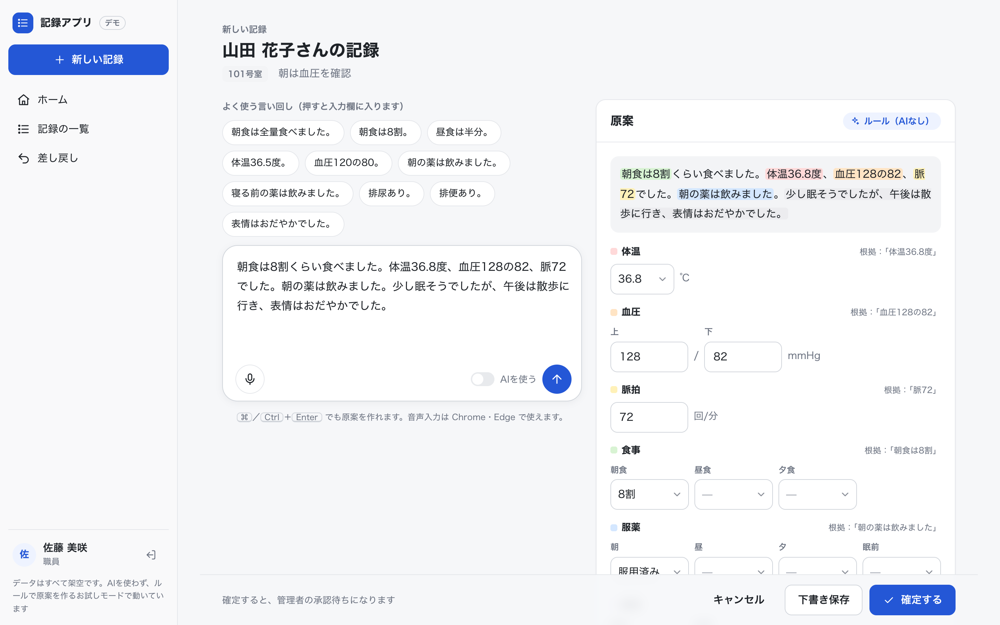
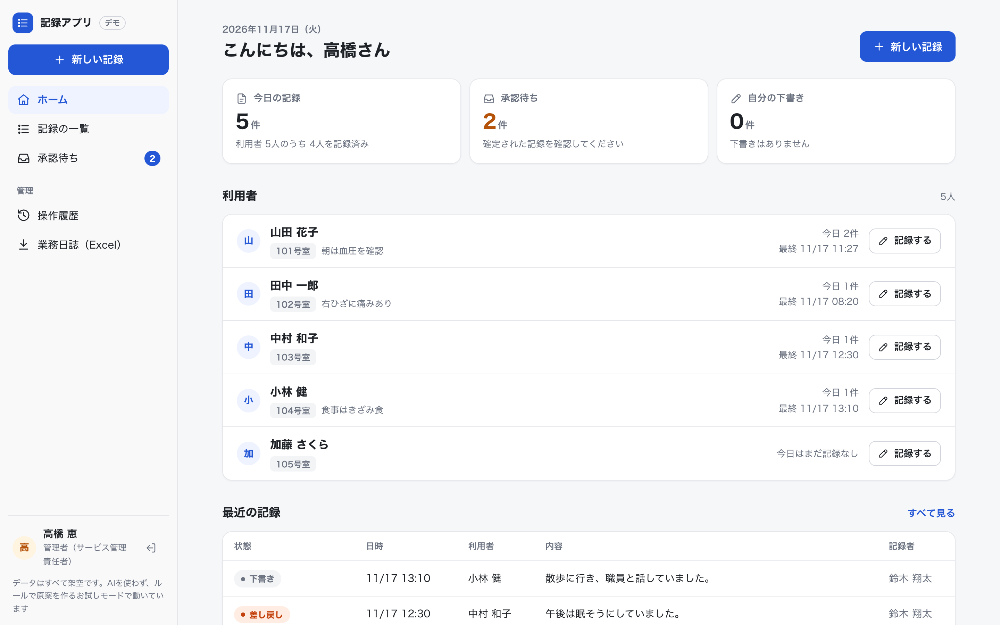
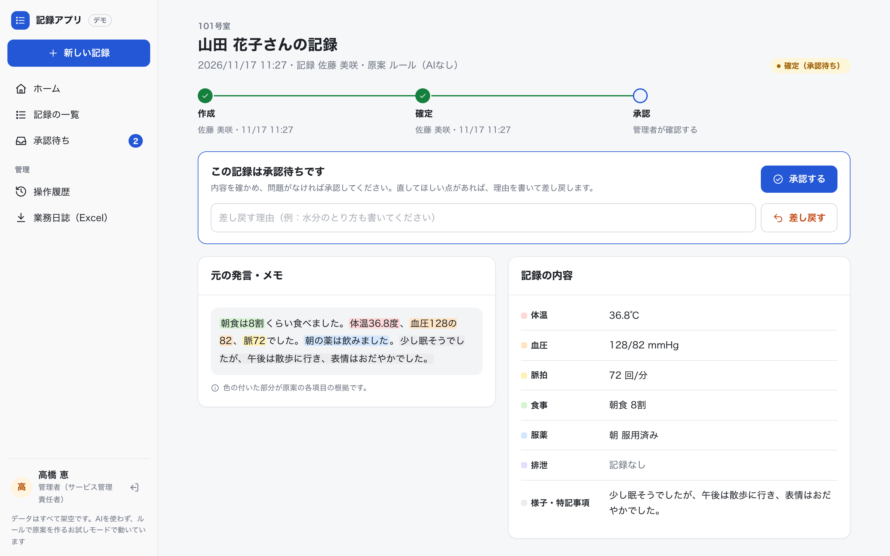
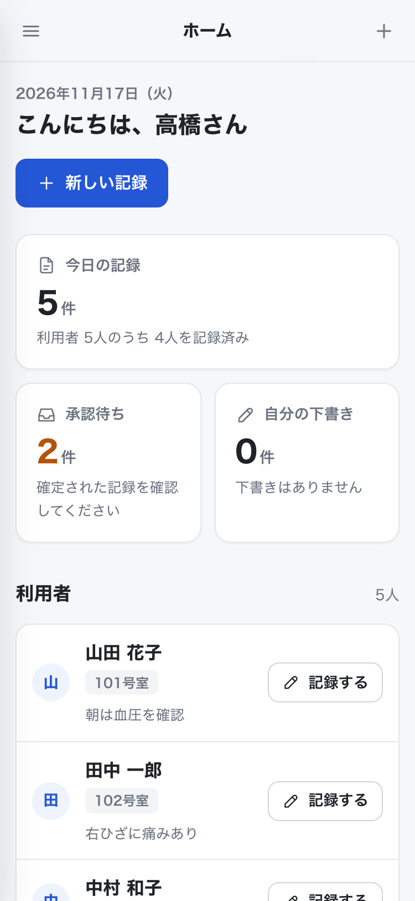
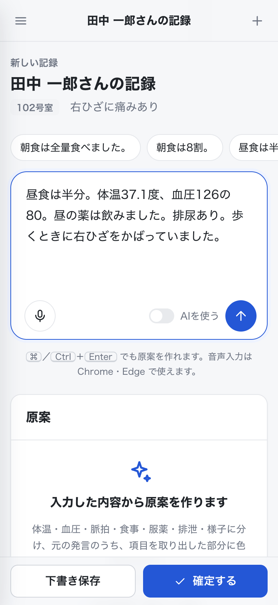
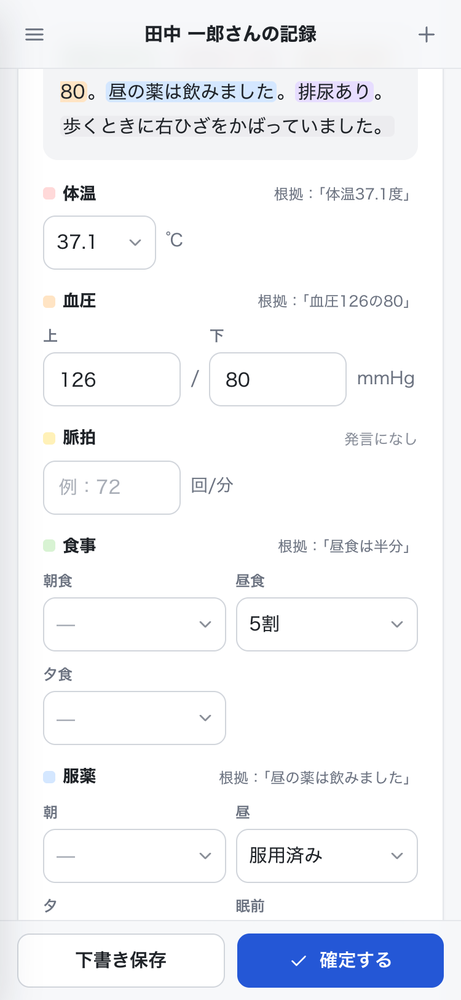
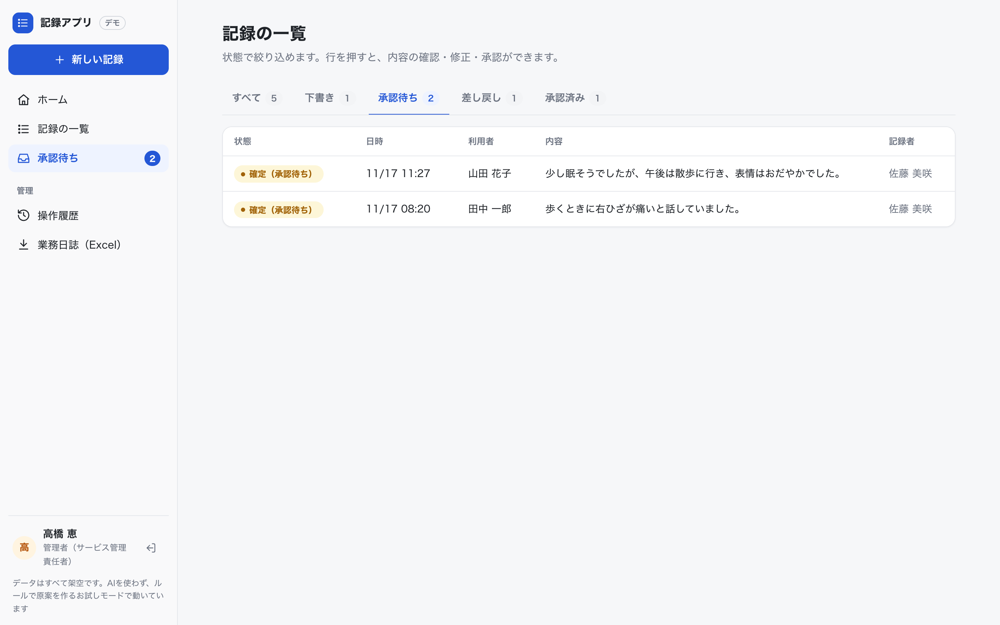
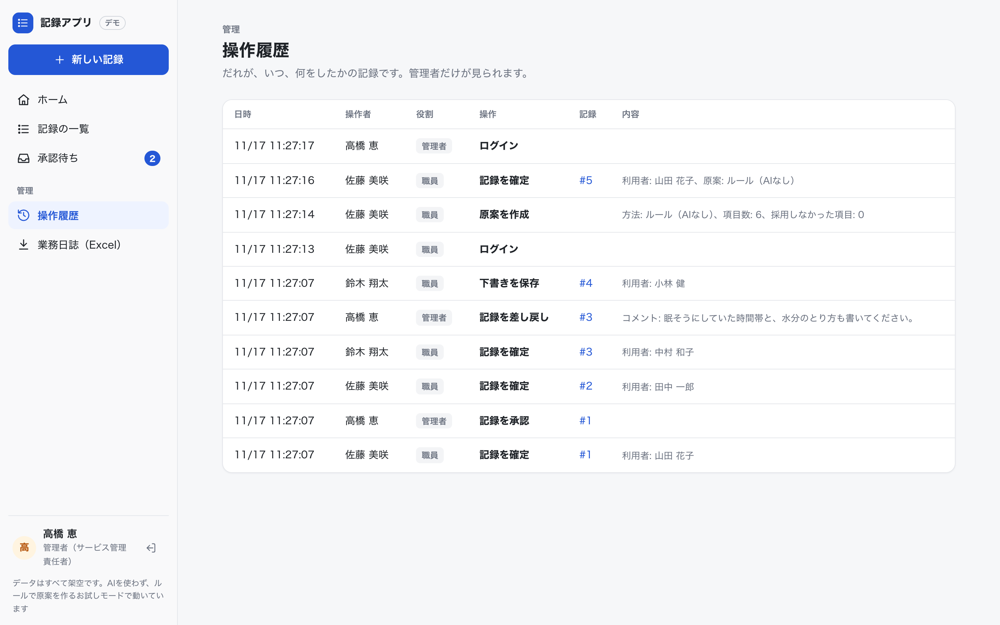
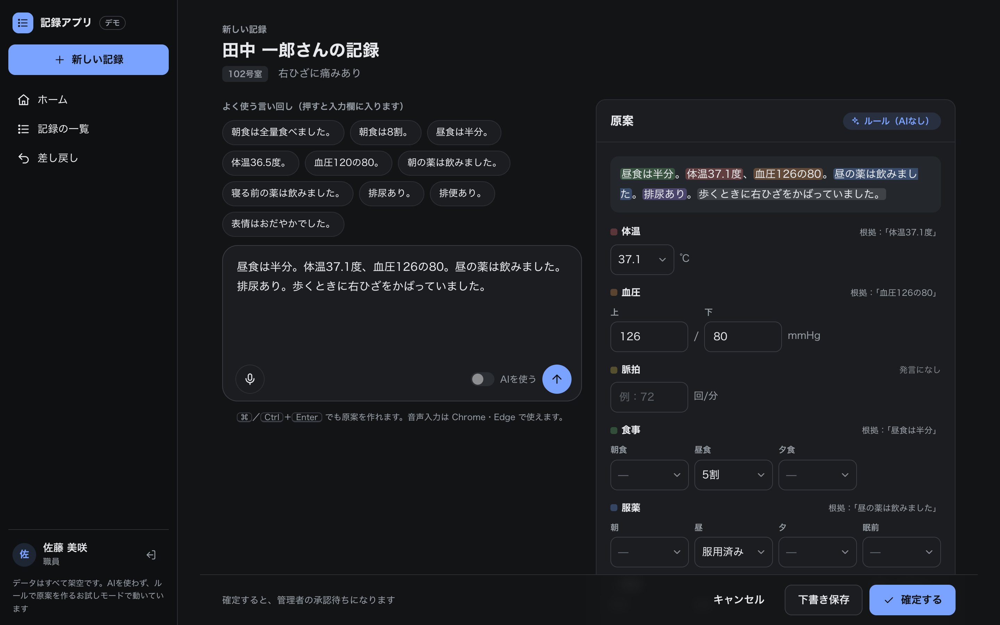
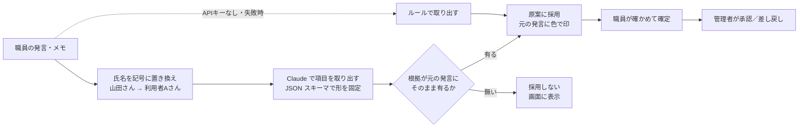

# 記録アプリ（デモ）

障がい者グループホームなどの支援記録について、音声やメモから原案を作り、職員が確かめて確定し、管理者が承認するまでの流れを試せるWebアプリです。
タブレットでの入力を主に想定し、スマホやPCでも崩れないように作っています。

ブラウザで試せるデモ：https://yutennnnn-kiroku.onrender.com

- ログイン画面で職員か管理者を選ぶと、パスワードなしで入れます。音声入力は Chrome・Edge などの対応ブラウザで使えます。
- しばらく使われていないと、最初の表示に1分ほどかかります。止まるたびにデータは初期化され、架空のサンプルデータに戻ります。
- 見に来た人はみな同じデータを使うので、入力した記録はほかの人にも見えます。実在の人の情報は入れないでください。
- データはすべて架空です。実在の法人・事業所・人物とは関係ありません。
- デモは API キーを設定していない「お試しモード」で動いています（AIの代わりに、ルールで原案を作ります）。
- ソースコードは非公開です。



| 管理者のホーム（やることの件数） | 承認待ちの記録（承認・差し戻し） |
|---|---|
|  |  |

| スマホ：ホーム | スマホ：入力 | スマホ：原案の確認 |
|---|---|---|
|  |  |  |

## 画面づくりで意識したこと

業務で毎日使われる SaaS（生成AIのチャット、クラウド会計など）でなじみのある操作に合わせ、初めての職員でも迷わないようにしています。

- 左のメニューのいちばん上に「新しい記録」を置き、承認待ちと差し戻しの件数もメニューに出す。アカウント欄はメニューの下にまとめ、タブレット縦とスマホではメニューを左から引き出す
- ホームでは「やること」として、今日の記録・承認待ち（職員は差し戻し）・自分の下書きの件数を最初に出す。押すとその一覧に移る
- 入力は大きな入力欄ひとつにまとめる。音声入力・「AIを使う」・送信のボタンは欄の中に、よく使う言い回しは欄の上に並べる。⌘／Ctrl＋Enter でも原案を作れる
- 体温・食事（朝食／昼食／夕食の量）・服薬（朝／昼／夕／眠前）・排泄（排尿／排便）は選択式にする。値の幅が広い血圧・脈拍は数字の欄（タブレットでは数字のキーボード）、様子・特記事項は自由に書く欄にし、どちらも薄い文字で入力例を出す
- 発言から作った原案は選択欄を選んだ状態で出す。「夜の薬」のように時間帯を決められないものは推測で選ばず、「欄から選んでください」と知らせる
- 原案のそばに作り方（ルール／AI）を表示し、「必ず内容を確かめてから確定してください」と注意書きを添える
- 記録ごとに、作成 → 確定 → 承認（差し戻し）の進み具合を表示する。管理者には承認と差し戻しのボタンを画面の上に出す
- 操作のあとに「記録を確定しました」などの短い通知を右下に数秒出す
- OS の設定に合わせて、ダークモードに切り替わる

| 記録の一覧（状態で絞り込み） | 操作履歴 | ダークモード |
|---|---|---|
|  |  |  |

## できること

- 入力：音声入力（ブラウザの Web Speech API）、よく使う言い回しのボタン、手入力
- 原案づくり：発言・メモから、体温・血圧・脈拍・食事・服薬・排泄・様子を取り出す
  - 各項目に、元の発言のどこから取ったか（根拠）を必ず付け、元の発言のその部分に色で印を付ける
  - 発言にない項目は空のままにし、推測で埋めない
  - AI を使うときも、根拠が元の発言の中に一字一句そのまま見つからない項目は採用しない（画面に「採用しなかった項目」として出す）
- 確定と承認：職員が確かめて確定し、管理者（サービス管理責任者）が承認するか、理由を付けて差し戻す
- 権限：承認・差し戻し・操作履歴の閲覧・帳票の出力は管理者だけ。確定・承認済みの記録は編集できない（画面だけでなくサーバー側でも拒否）
- 操作履歴：ログイン・原案づくり・保存・確定・修正（変更前後）・承認・差し戻し・出力を記録
- 帳票：その日の確定・承認済みの記録を、業務日誌の Excel にまとめて出力

## AI に記録を任せるときの考え方



- AI が事実を足さないように、出力を「項目・値・根拠」の形（JSON スキーマ）に固定し、根拠が元の発言に無いものは捨てる
- 利用者・職員の氏名は AI に送る前に「利用者A」「職員A」などに置き換える。対応表はサーバーの中だけで使い、AI には送らない
- 原案はあくまで下書きで、確定は職員、承認は管理者が行う
- API キーがない、接続できない、回答が断られた、のどれかのときは、ルールの方法に切り替えて動き続ける

API 経由で送ったデータの扱い（保存期間・学習への利用の有無）は提供元の規約で決まります。導入するときは、最新の規約と契約の内容を確認したうえで設定します。

## 構成

```
app/
  main.py        画面とAPI（FastAPI）。ログイン・権限・CSRF・確定・承認・差し戻し・出力
  db.py          データベース（SQLAlchemy）。既定は SQLite、DATABASE_URL で PostgreSQL に切り替え
  extract.py     ルールで項目を取り出す（根拠の文字列と位置つき）
  ai.py          Claude で原案を作る（JSON スキーマ・根拠の確認・失敗時はルールへ）
  privacy.py     AI に送る前の仮名化と、手元での復元
  export.py      業務日誌（Excel）
  seed.py        架空の職員・利用者・記録
  templates/     画面（Jinja2）。アイコンは _icons.html に自前で描いた線画
  static/        CSS（タブレット・スマホ対応、ダークモード）と JavaScript（メニュー、音声入力、原案の表示）
scripts/         README のスクリーンショットの撮影
tests/           pytest（画面の流れ・権限・CSRF・取り出し・仮名化・AIの根拠チェック）
```

## 実際に導入するときに足すところ

- ログイン：社内の認証（SSO など）とつなぎ、デモの「パスワードなしで選ぶ」画面をなくす
- 通信と保存：https での配信、データベースとバックアップの暗号化、記録の保存期間の設定
- 帳票：既存の Word・Excel の様式に合わせた出力、行政提出書類の原案づくり
- 入力：多言語（外国人職員）の表示

## 技術

Python 3.12 / FastAPI / SQLAlchemy 2 / Jinja2 / HTML・CSS（レスポンシブ）/ JavaScript（Web Speech API）/ Anthropic Python SDK / openpyxl / SQLite・PostgreSQL / pytest / Docker
